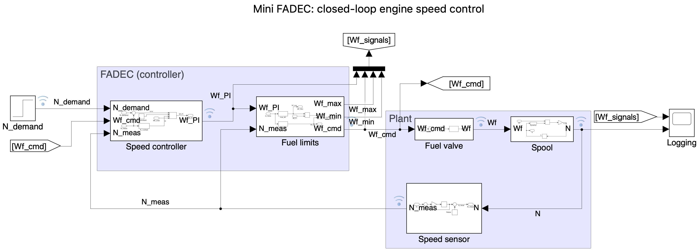
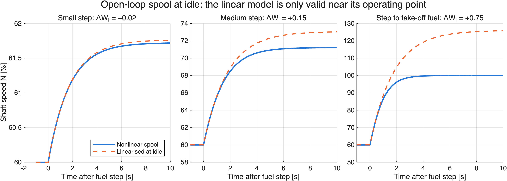
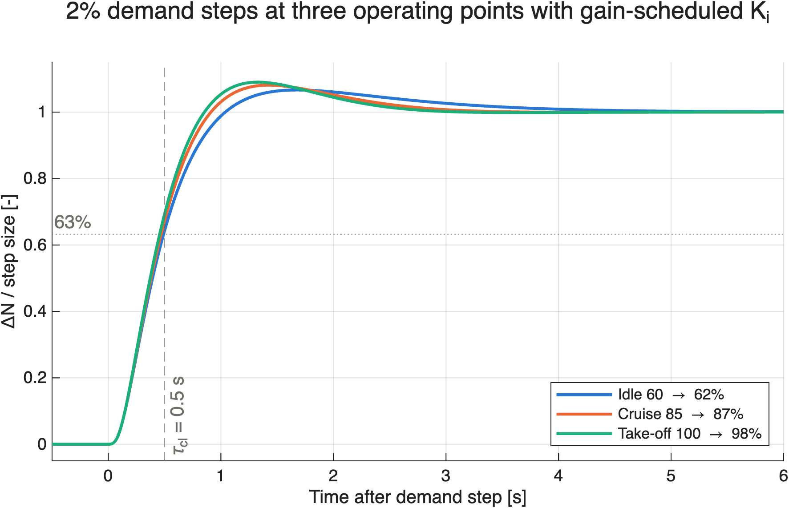
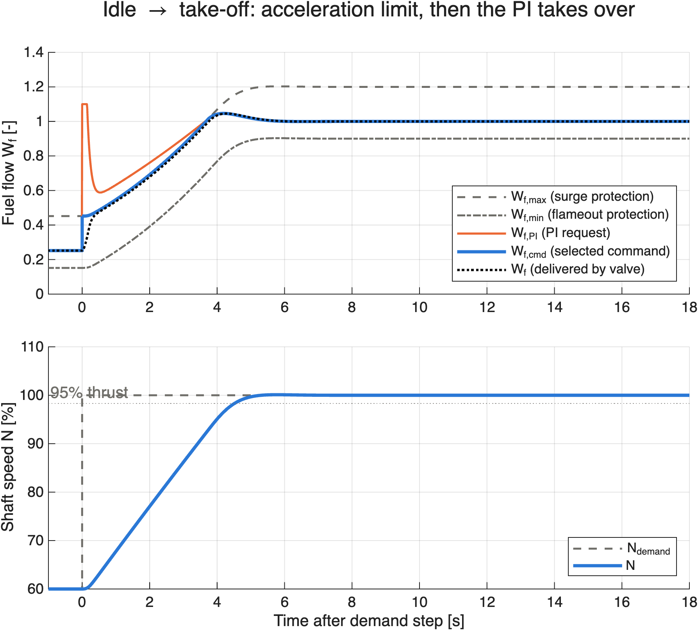
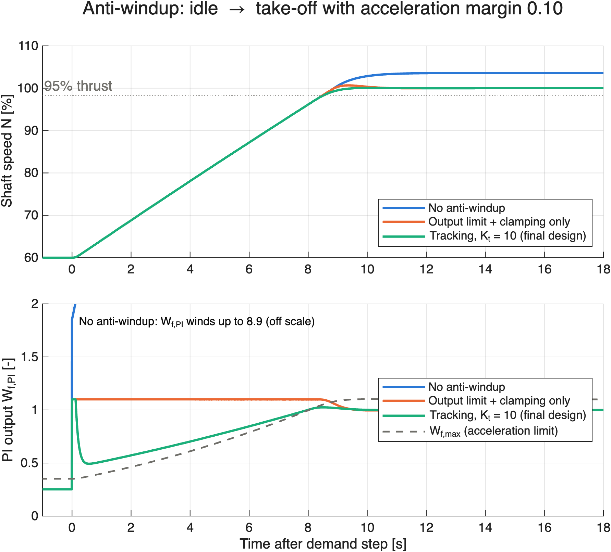
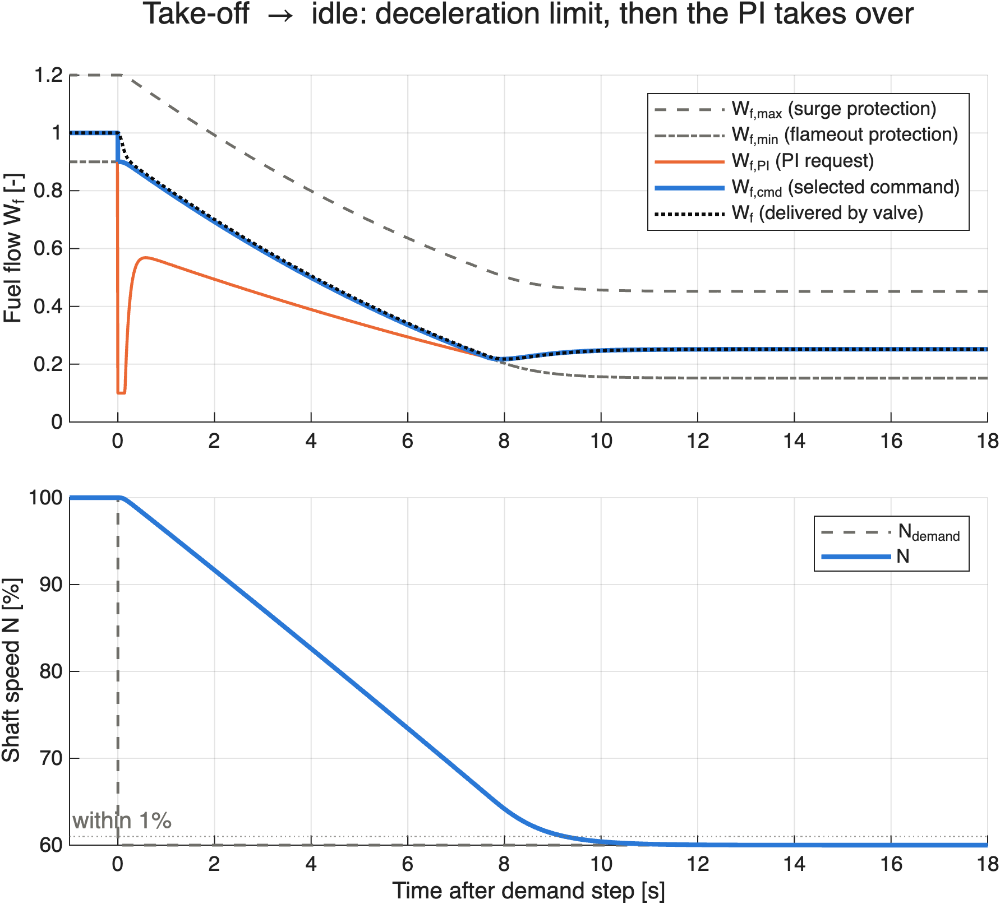
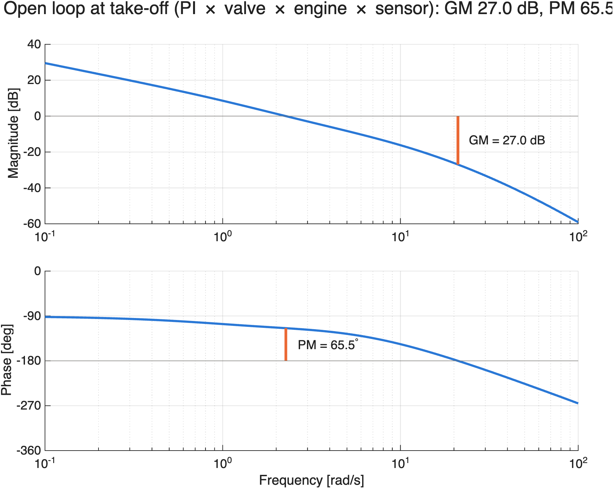

# Mini FADEC: Gain-Scheduled Fuel Controller for a Single-Shaft Gas Turbine

A Simulink project designing and testing a simplified **Full Authority Digital Engine Control (FADEC)** speed controller: a nonlinear engine-shaft model, a gain-scheduled PI speed loop, a realistic fuel valve, FADEC-style acceleration/deceleration protection with min/max selection, tracking anti-windup, and a robustness study.

> **Key results (final design, nominal engine)**
> - Idle → 95% take-off thrust in **≈ 4.5 s** (target ≤ 5 s), overshoot **≈ 0.1%**
> - Take-off → idle within 1% in **≈ 9.3 s**, no undershoot
> - Same closed-loop response at idle, cruise and take-off (gain scheduling)
> - Gain margin **≈ 27 dB**, phase margin **≥ 65°** at all operating points, including valve, sensor and sampling lags



---

## Contents
1. [Problem and requirements](#1-problem-and-requirements)
2. [Engine model](#2-engine-model)
3. [Linearisation](#3-linearisation)
4. [Speed controller design](#4-speed-controller-design)
5. [Actuator and protection logic](#5-actuator-and-protection-logic)
6. [Results](#6-results)
7. [Robustness](#7-robustness)
8. [Lessons learned](#8-lessons-learned)
9. [Limitations and further work](#9-limitations-and-further-work)
10. [Repository structure and how to run](#10-repository-structure-and-how-to-run)
11. [Sources](#11-sources)

---

## 1. Problem and requirements

The pilot's thrust lever sets a demanded shaft speed $N_{demand}$. The controller can only act on the **fuel metering valve**; it must adjust fuel flow $W_f$ so that the actual shaft speed $N$ follows the demand, without breaking the engine.

| Requirement | Target |
|---|---|
| Idle (60%) → 95% thrust (N = 98.3%, since F ∝ N³) | ≤ ~5 s (comparable to engine certification acceleration requirements) |
| Speed overshoot | ≤ 1–2% |
| Steady-state error | zero |
| Response at different operating points | consistent |
| Protection | no surge (fuel-rate limit on acceleration), no flameout (minimum fuel on deceleration), fuel within valve limits |

---

## 2. Engine model

A single-shaft (single-spool) engine, with compressor and turbine on one shaft, modelled by a lumped torque/power balance:

$$\frac{dN}{dt} = k\left[W_f - W_{f,ss}(N)\right], \qquad W_{f,ss}(N) = \left(\frac{N}{100}\right)^{n}$$

Fuel above the steady-state requirement $W_{f,ss}(N)$ produces excess turbine power and accelerates the shaft.

| Parameter | Value | Basis |
|---|---|---|
| N | % of take-off speed | normalised |
| W_f | 1.0 = sea-level take-off fuel | normalised |
| Idle | N = 60%, W_f = 0.25 | assumption (typical core idle 60–70%) |
| n | 2.7 | fitted so the curve passes through (60%, 0.25) and (100%, 1.0) |
| k | 50 %/s per unit fuel | calibrated to give realistic time constants (1.76 s at idle, 0.74 s at take-off) |

**These are representative values, not manufacturer data.** The aim is realistic behaviour (slow at idle, fast at high power), not a specific engine.

---

## 3. Linearisation

Taylor-expanding about an equilibrium $(N_0, W_{f0})$ and writing deviations $\delta N, \delta W_f$:

$$G(s) = \frac{\delta N}{\delta W_f} = \frac{K}{\tau s + 1}, \quad a = \frac{n}{100}\left(\frac{N_0}{100}\right)^{n-1}, \quad K = \frac{1}{a}, \quad \tau = \frac{1}{k a}$$

| Operating point | K (% per unit fuel) | τ (s) |
|---|---|---|
| Idle (60%) | 88.3 | 1.76 |
| Cruise (85%) | 48.8 | 0.98 |
| Take-off (100%) | 37.0 | 0.74 |

Hand-derived transfer functions were verified against numerical linearisation (`linmod`) of the Simulink model. Linear and nonlinear responses agree for small steps and diverge for large ones, which is why the controller is designed on linear models but always tested on the nonlinear one.



Note that $K/\tau = k$ at every operating point, a fact used in the gain-scheduling design below.

---

## 4. Speed controller design

### PI design by pole placement
Choosing $K_i/K_p = 1/\tau$ cancels the engine pole and gives a first-order closed loop with a chosen time constant $\tau_{cl}$:

$$K_p = \frac{\tau}{K\,\tau_{cl}} = \frac{1}{k\,\tau_{cl}}$$

**τ_cl = 0.5 s** was chosen because it is:
- faster than the engine alone (3.5× faster than the idle τ), which is the purpose of feedback;
- slower than the fuel valve allows: with a 0.08 s valve lag the loop becomes underdamped for τ_cl < ~0.32 s;
- moderate in fuel demand (initial fuel "overdrive" ≈ τ/τ_cl).

### Gain scheduling
Because $\tau/K = 1/k$, **K_p = 0.04 is constant**; only K_i needs scheduling, using the **measured** speed:

$$K_i(N) = c \cdot K_p \cdot k \cdot a(N)$$



### Why c = 1.5 rather than exact cancellation (c = 1)
Exact cancellation gave identical responses at all operating points, but **hid** the engine's slow pole rather than removing it. During deceleration, the protection logic handed control back to the PI in a "mismatched" state and the engine coasted to idle with a time constant of **1.77 s, matching the engine's open-loop idle τ (1.76 s)**. Increasing K_i moves the PI zero away from the engine pole and removes this slow mode, at the cost of some overshoot on small demand steps (the PI zero now sits near the closed-loop poles).

| c | Small-step overshoot | Idle → 95% thrust | Overshoot | Take-off → idle (within 1%) |
|---|---|---|---|---|
| 1 | 0.5% | 5.1 s | none | 10.5 s (slow tail) |
| **1.5 (chosen)** | **6.7%** | **4.5 s** | **0.1%** | **9.3 s** |
| 2 | 12.4% | 4.4 s | 0.5% | 8.9 s |

(Small-step overshoot is for a 2% step at idle, as a percentage of the step. Full data: `results/c_study.csv`; figure: `figures/extra/c_tradeoff.png`.)

---

## 5. Actuator and protection logic

### Fuel valve
| Property | Value | Purpose |
|---|---|---|
| Limits | 0.1–1.1 | 10% margin above take-off fuel; minimum flow prevents flameout |
| Rate limit | ±1 per second | finite servo speed, avoids pressure shocks |
| Lag | 0.08 s | servo response, well separated from the 0.5 s speed loop |

### Acceleration and deceleration schedules
$$W_{f,max}(N) = W_{f,ss}(N) + 0.20 \quad\text{(surge protection, limits } dN/dt \le k \times 0.20)$$
$$W_{f,min}(N) = W_{f,ss}(N) - 0.10 \quad\text{(flameout protection)}$$

The margins stand in for real compressor surge-margin and lean-blowout data, which this model does not include.

### Min/max selection
$$W_{f,cmd} = \max\big(\min(W_{f,PI},\ W_{f,max}),\ W_{f,min}\big)$$

The classic FADEC selection structure: no switching logic is needed, and the order of the chain sets which protection has priority if limits ever cross (they cannot in this model).



### Anti-windup: how it evolved
Compared in the final model with a tight acceleration margin (0.10), so the PI spends ~8 s behind the acceleration limit:

| Method | Peak PI output | Overshoot | What happens |
|---|---|---|---|
| None | 8.9 | **3.6%** | integrator winds up far beyond anything the valve can deliver |
| Output saturation + clamping | 1.1 | 0.7% | stops windup at the valve limit, but **not behind the Min block**: the PI still holds its output above W_f,max |
| **Tracking** (track = final command) | 1.1 | **0.06%** | PI output follows the fuel actually used → no windup |

The steady gap between PI output and the actual command under tracking is ≈ $K_i e / K_t$, so **K_t is scaled with K_i**. The final design uses **K_t = 10**, slightly stronger than the ratio rule suggests for c = 1.5 (≈ 7.5), keeping the PI output close to the actual command for smooth, overshoot-free handovers while still meeting the 5 s target.



---

## 6. Results

### Final design
- Margins +0.20 / −0.10
- K_p = 0.04; K_i = 1.5·K_p/τ(N), scheduled on measured N
- Tracking anti-windup, K_t = 10
- Valve 0.1–1.1, ±1/s, 0.08 s lag
- Discrete-time controller, T_s = 0.01 s (fixed-step ode4 solver, 0.001 s)

| Test | Result |
|---|---|
| Idle → take-off (60 → 100%): time to 95% thrust | **≈ 4.5 s** ✅ |
| Overshoot | **≈ 0.1%** ✅ |
| Take-off → idle (100 → 60%): time to within 1% | **≈ 9.3 s**, no undershoot |
| Small steps (2%) at idle / cruise / take-off | 6.7% / 8.1% / 9.0% overshoot (0.13–0.18% absolute speed) |



### Acceleration margin trade study (with gain scheduling)
The ramp rate is ≈ k × margin, so the 95%-thrust time is predicted well by $38.3/(k \times \text{margin}) + \sim0.7\,\text{s}$:

| Margin | Time to 95% thrust | Overshoot |
|---|---|---|
| 0.10 | 8.5 s | 0.06% |
| 0.15 | 5.8 s | 0.09% |
| **0.20** | **4.5 s** | 0.11% |

Before gain scheduling, increasing the margin barely helped: the slow PI tail near take-off dominated. **Each fix moved the bottleneck.**

---

## 7. Robustness

Each case changes one thing from nominal; the controller is not re-tuned. Nominal already includes the discrete controller (T_s = 0.01 s) and a 0.02 s sensor lag.

| Case | Idle → 95% thrust | Overshoot | Take-off → idle | Small-step overshoot (idle) |
|---|---|---|---|---|
| Nominal | 4.5 s ✅ | 0.1% | 9.3 s | 6.7% |
| Shaft 30% heavier (k −30%) | 6.1 s ❌ | 0.5% | 12.3 s | 11.7% |
| Shaft 30% lighter (k +30%) | 3.8 s ✅ | none | 7.8 s | 3.2% |
| Fuel valve lag 0.2 s | 5.0 s ⚠️ | 0.2% | 10.1 s | 13.6% |
| Sensor noise (σ ≈ 0.1%) | 4.5 s ✅ | 0.1% | 9.3 s | 7.5% |

Full data: `results/robustness.csv`.

**Stability margins** (open loop: PI × valve × engine × sensor × sampling delay):

| Operating point | Gain margin | Phase margin |
|---|---|---|
| Idle | 27.3 dB | 70.7° |
| Cruise | 27.1 dB | 67.0° |
| Take-off | 27.0 dB | 65.5° |

Gain crossover is at ≈ 2 rad/s (= 1/τ_cl, as designed); phase crossover is at ≈ 21 rad/s, set by the valve, sensor and sampling lags.



**Findings**
- **Big-step speed scales with the engine.** Acceleration time scales with k because the schedules limit **fuel**, not **acceleration rate**, so a 30% heavier engine misses the 5 s target.
- **Small-step overshoot depends on the engine too.** K_p is fixed, so a heavier engine lowers the loop gain and slows the closed loop while the PI zero stays where it was designed; the zero then dominates and overshoot nearly doubles (11.7%). A lighter engine does the opposite (3.2%). All cases stay stable.
- **A slower valve** (0.2 s, beyond the critical τ_cl/4 ≈ 0.125 s) roughly doubles small-step overshoot (13.6%) but remains stable; big steps barely change because they are schedule-limited.
- **Sensor noise ends up in the fuel command, not the shaft speed.** The engine's inertia filters it; the cost is valve activity (≈ K_p × noise), which is also why the controller is PI, not PID.
- **A failed speed sensor** (reading ≈ 0 in a mis-wired test) drove fuel to its maximum and N to ≈ 103.6% with nothing to stop it, which shows why real FADECs validate sensors and have independent overspeed protection.

---

## 8. Lessons learned

- **The textbook design was the easy part.** The PI loop worked first time on small steps; nearly all the effort went into limits, handovers and interactions between protection logic and the controller.
- **Pole cancellation hides a slow pole; it doesn't remove it.** It reappears whenever the controller starts from a mismatched state, which here happened at every protection handover during deceleration.
- **Poles alone don't predict overshoot; zeros matter.** A damping-ratio-only prediction put the c = 2 small-step overshoot at ~2%; it was 12%. Including the PI zero explained it.
- **A test that changes nothing is a bug, not a result.** The first scripted ±30% engine runs matched nominal exactly: the engine block was reading the controller's nominal k instead of the perturbed k_true. Plant and controller parameters must be kept separate.
- **Clamping anti-windup isn't enough once there are min/max limits outside the PI.** Tracking the final command is needed.
- **Predict before simulating.** Every test was preceded by a hand prediction; the mismatches were where the learning happened.

---

## 9. Limitations and further work

- **N-dot (acceleration-rate) control:** schedule dN/dt rather than fuel so that acceleration time is insensitive to engine condition (fixes the k −30% case).
- **2-DOF PI with setpoint weighting:** remove the PI zero from the demand path to eliminate small-step overshoot while keeping the stronger K_i.
- **Overspeed limiter and sensor validation** as independent protections.
- **Physics-based engine model:** compressor/turbine power balance, then a full component model (e.g. NASA T-MATS) and a twin- or three-spool engine.
- **Real limit data:** replace the constant margins with surge-margin and lean-blowout schedules in terms of W_f/P₃ (ratio units).

---

## 10. Repository structure and how to run

```
mini-fadec/
├── parameters.m                  % all parameters (loaded automatically by the model)
├── mini_fadec.slx                % final model: FADEC controller + fuel valve + engine
├── spool_linmod.slx              % Inport/Outport version for linmod
├── compare_lin.slx               % open-loop engine: nonlinear vs linearised
├── run_lin.m                     % numerical linearisation check
├── make_figures.m                % regenerates every figure and results table
├── figures/                      % README figures
│   └── extra/                    % supporting figures
└── results/                      % CSV tables behind the numbers quoted above
```

Requirements: MATLAB/Simulink with the Control System Toolbox.

1. Open `mini_fadec.slx` and run it. `parameters.m` is loaded automatically by the model callbacks; the default test is idle → take-off (`N0 = 60`, `dNd = 40`).
2. For another test, set the start point and step in the Command Window first, e.g. `N0 = 100; dNd = -40;` for take-off → idle. `clear N0 dNd` returns to the default.
3. Run `make_figures` to regenerate every figure in `figures/` and the tables in `results/` (about a minute or two). `make_figures("05")` redoes a single figure; `help make_figures` lists the IDs.

---

## 11. Sources

The model was built from first principles and course material; it uses no published engine data.

- Cambridge Engineering course material on linear systems and control.
- MathWorks documentation: PID Controller block (anti-windup, tracking mode), `linmod`, `margin`.
